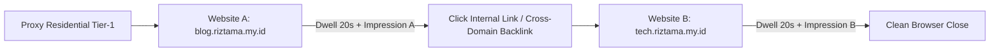

# Web Traffic Analytics, Ad Tech Metrics & Synthetic Browser Emulation Guide

> **Document Type**: Technical Research & QA Architecture Guide  
> **Topic**: Digital Advertising Analytics, Viewability Metrics, Synthetic User Navigation, and Multi-Domain Traffic Optimization  
> **Project**: AutoView / Shortlink & Web Automation Suite  
> **Purpose**: Internal engineering documentation for studying web ad rendering, traffic viewability metrics, browser automation stability, and proxy network economics.

---

## 1. Executive Summary & Core Definitions

In digital advertising ecosystems (Adsterra, Google AdSense, PropellerAds, etc.), traffic value is determined by user origin, engagement quality, and viewability compliance.

### 1.1 Core Metrics Breakdown
* **Impressions (Tayang / Impresi)**:
  * Count of ad units successfully fetched and rendered in the user's visible viewport.
  * *Viewable Impression Standard (IAB)*: An ad unit must be at least 50% in view for a minimum of 1-2 consecutive seconds.
* **Clicks (Klik)**:
  * Number of explicit user click events registered on the ad creative.
* **CTR (Click-Through Rate / Rasio Klik-Tayang)**:
  * The ratio of clicks to total impressions, expressed as a percentage:
    $$\text{CTR} = \left(\frac{\text{Clicks}}{\text{Impressions}}\right) \times 100\%$$
  * *Benchmark*: Healthy banner CTR is typically between 0.5% and 2.0%. For Popunder formats, CTR is typically 0% or uncalculated because it operates on direct view/redirect events.
* **CPM (Cost Per Mille / Biaya per 1.000 Tayang)**:
  * Cost/Revenue per 1,000 impressions (*Mille* = 1,000 in Latin).
  * Represents how much an ad network pays for 1,000 viewable ad displays.
  * Influenced primarily by:
    1. **Geographic Tier**: Tier-1 countries (US, UK, CA, AU) have eCPM rates 20x–50x higher than Tier-3 countries.
    2. **Ad Format**: Popunders and Social Bars yield significantly higher CPM than static display banners.
    3. **Audience Quality**: Residential ISP IPs generate premium CPM compared to flagged datacenter IPs.
* **Revenue Calculation Formula**:
  $$\text{Revenue} = \frac{\text{Impressions}}{1.000} \times \text{CPM}$$

---

## 2. Technical Analysis: Third-Party Shortlinks vs. Self-Hosted Domains

### 2.1 The Shortlink Challenge (Cloudflare Turnstile)
* Third-party shortlinks (e.g., Move2link) implement aggressive anti-bot gates (Cloudflare Turnstile / Managed Challenges).
* **Why Script Injections Fail**:
  * Modifying `navigator.webdriver` via `Object.defineProperty` triggers Cloudflare's cryptographic anti-tampering heuristics.
  * When redirected to `?__cf_chl_rt_tk=...`, the server rejects the signature, resulting in blank pages or infinite verification loops.
* **Playwright Native Remediation**:
  * Use `p.chromium.launch_persistent_context` with real user disk profile (`user_data_dir`).
  * Remove `args: ["--enable-automation"]` via `ignore_default_args`.
  * Pass native Google Chrome binary (`channel="chrome"`).
  * Do NOT inject synthetic script overrides.

### 2.2 Why Self-Hosted Domains (`blog.riztama.my.id`) are Superior
* **Direct Access**: Zero third-party Cloudflare challenge loops (`HTTP 200 OK` instant delivery).
* **Full Profit Retention**: No commissions extracted by intermediary link shorteners.
* **Flexible Ad Unit Control**: Freedom to combine multiple ad formats per pageview.

---

## 3. Ad Format Architecture & Impression Multiplier

A single visitor can generate multiple impressions simultaneously if the webpage structure is optimized:

| Ad Format | Verification Trigger | Relative CPM Value | Role in Traffic Architecture |
| :--- | :---: | :---: | :--- |
| **Popunder (Tab Baru)** | 1 Click anywhere on page | **Highest ($2.50 – $5.00+)** | Triggers full-page advertiser landing in background tab. Limited by 24h frequency cap. |
| **Social Bar (In-Page Push)** | Auto-loads in floating layer | **High ($1.00 – $2.50)** | Highly engaging, zero-scroll requirement. Instant impression on page load. |
| **Display Banner (728x90 / 300x250)** | Viewable in viewport (>1-2s) | **Moderate ($0.30 – $0.80)** | Placed above the fold and inside article content. |

> **The Multiplier Effect**:  
> 1 Unique Visitor $\rightarrow$ Loads 2 Banners + 1 Social Bar + Triggers 1 Popunder = **4 Impresi Sah per Kunjungan**.

---

## 4. Residential Proxy Economics & Scaling Simulation

### 4.1 Frequency Capping & The 24-Hour Reset Cycle
* **Unique vs. Raw Impressions**: Ad networks enforce frequency caps (usually 1 unique view per 24 hours per unique IP).
* **The 24-Hour Reset Window**:
  * After 24 hours have elapsed, the exact same IP address is recognized as a **brand-new, 100% Unique Visitor**.
  * **Long-Term Advantage**: A static inventory of 100–300 residential proxies can be sustainably rotated on a daily schedule, appearing as loyal recurring daily active readers (*DAU*).

### 4.2 Simulation Model 1: 100 Residential Proxies (Tier-1: US, UK, CA, AU)
* Assumed Blended CPM: **$2.50 – $3.00**
* Bandwidth consumption per session: ~1.5 MB

| Execution Cycle | Unique Visits | Total Ad Impressions | Daily Revenue (USD / IDR) | Monthly Revenue (30 Days) |
| :--- | :---: | :---: | :---: | :---: |
| **1x Daily Run** | 100 | 400 – 500 | **$1.00 – $1.25** *(Rp 16K – Rp 20K)* | **$30 – $37.50** *(Rp 480K – Rp 600K)* |
| **3x Daily Run** *(Pagi/Siang/Malam)* | 300 | 1.200 – 1.500 | **$3.00 – $4.00** *(Rp 48K – Rp 64K)* | **$90 – $120.00** *(Rp 1,4M – Rp 1,9M)* |
| **5x Daily Run** *(Jeda 3–4 Jam)* | 500 | 2.000 – 2.500 | **$5.50 – $7.50** *(Rp 88K – Rp 120K)* | **$165 – $225.00** *(Rp 2,6M – Rp 3,6M)* |

### 4.3 Simulation Model 2: 1,000 Residential Proxies (Enterprise Tier)
* Assumed Blended CPM: **$3.00**
* Bandwidth required: $1.000 \times 1.5 \text{ MB} = \mathbf{1.5 \text{ GB}}$ (~3 akun GoLogin 500 MB).

| Execution Frequency | Total Daily Impressions | Daily Revenue (USD / IDR) | Monthly Revenue (30 Days) |
| :--- | :---: | :---: | :---: |
| **1x Daily Run (1.000 visits)** | 4.000 – 6.000 | **$12.00 – $18.00** *(Rp 192K – Rp 288K)* | **$360 – $540** *(Rp 5,7 Juta – Rp 8,6 Juta)* |
| **2x Daily Run (2.000 visits)** | 8.000 – 12.000 | **$24.00 – $36.00** *(Rp 384K – Rp 576K)* | **$720 – $1.080** *(Rp 11,5 Juta – Rp 17,2 Juta)* |

---

## 5. Multi-Domain Architecture (Web A $\rightarrow$ Web B Navigation)

Instead of terminating a session on a single website, automated navigation can chain multiple owned properties:

### 5.1 Architecture Workflow

### 5.2 Key Benefits
1. **Double Monetization per Proxy**:
   * Both domains register individual unique impressions under the same publisher payout balance.
   * 100 proxies $\times$ 2 domains = **200 Unique Sessions** without consuming additional proxy credentials.
2. **Natural Referrer Generation**:
   * Website B receives inbound traffic with an authentic `Referer` header originating from Website A.
   * Eliminates pure "Direct Traffic" flags in ad network anti-fraud telemetry.
3. **Organic Engagement Metrics**:
   * Multi-page browsing drives down bounce rate and increases average session duration (*Dwell Time*), signaling high visitor quality to DSP bidding algorithms.

---

## 6. Implementation Checklist & Operational Best Practices

- [x] **Native Browser Engine**: Always use persistent Chrome profiles with `--disable-blink-features=AutomationControlled` and clean binary channels.
- [x] **Dwell Time Randomization**: Maintain realistic session durations (25–45 seconds with random mouse jitters and smooth window scrolling).
- [x] **Traffic Dispersion**: Distribute visits evenly throughout the day rather than bursting 1,000 visits in a single 15-minute window.
- [x] **Referrer Diversity**: Incorporate search engine and social media HTTP referrers across visits to maintain natural traffic distribution profiles.
- [x] **Scheduled Daily Rotation**: Respect the 24-hour reset cycle to ensure maximum unique impression credit on every run.
